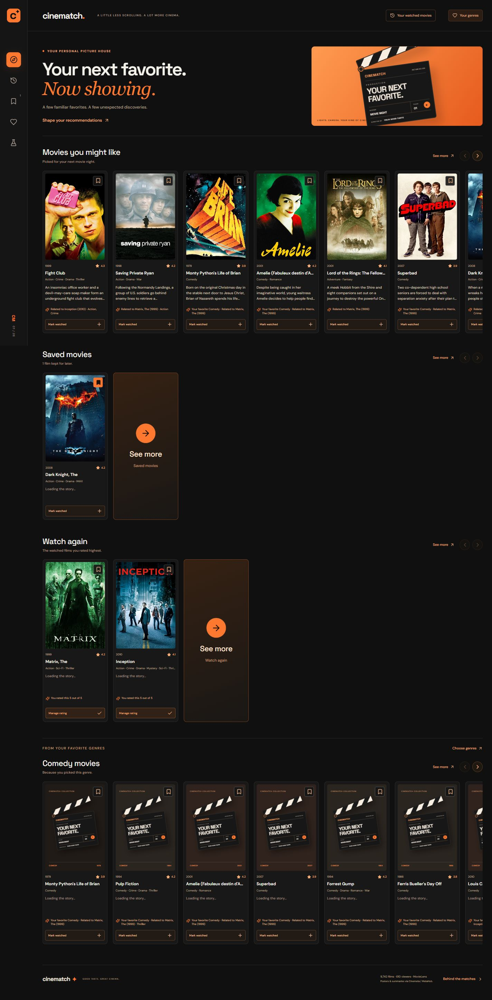
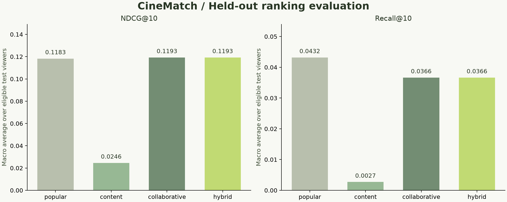
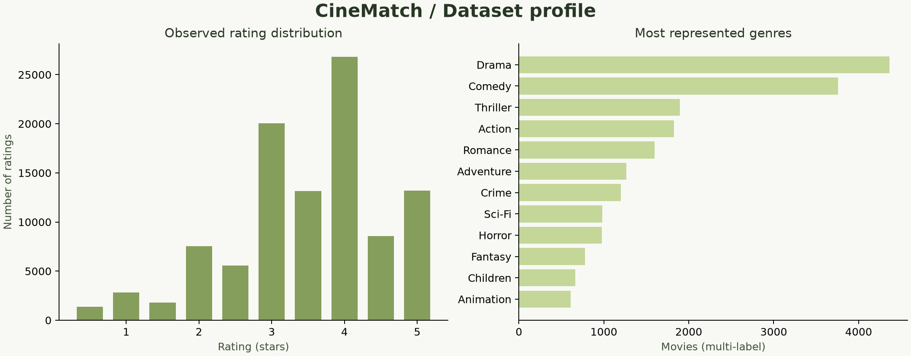

# CineMatch — Movie Recommendation Engine

**A little less scrolling. A lot more cinema.**

Submission handover: [requirements checklist and upload guide](SUBMISSION_READY.md) · [project report](docs/PROJECT_REPORT.md) · [verification evidence](reports/VERIFICATION.md).

Published repository: [avanindra2006/codtech-movie-recommendation-engine](https://github.com/avanindra2006/codtech-movie-recommendation-engine) · [automated checks](https://github.com/avanindra2006/codtech-movie-recommendation-engine/actions/workflows/check.yml).

CineMatch is a complete local movie discovery app. Rate movies you know, get personalized recommendations with understandable reasons, adjust the genre/era/variety, and bookmark films for later. A sparse hybrid engine blends audience rating patterns, TF-IDF title/genre similarity, and Bayesian popularity. React supplies the interface; FastAPI serves predictions and the built app.



## CODTECH Internship Details

| Field | Value |
|---|---|
| Intern ID | **CITS9600** |
| Full Name | **Bobbasani Avanindra** |
| No. of Weeks | **4** |
| Project Name | **CineMatch — Movie Recommendation Engine** |
| Project Scope | Design, implement, and evaluate an explainable hybrid recommendation system using public movie metadata and ratings, with data cleaning, visual analysis, a reproducible temporal experiment, a FastAPI backend, and a desktop-focused React discovery dashboard. |

## What is included

- Complete commented source code, reusable model modules, and a command-line interface.
- An orange-and-black desktop dashboard with horizontal movie rows, clapperboard placeholders, API synopses, separate watched-history and favorite-genre pages, full collection pages, personalized reasons, ranking filters, bookmarks, and an evaluation view.
- The exact MovieLens latest-small dataset snapshot, its original license/README, SHA-256 provenance, and a separate original synthetic demo dataset.
- Fitted production artifacts, temporal split assignments, validation tuning, per-viewer metrics, sample recommendations, analysis charts, and genuine application screenshots.
- Model/API/data/evaluation tests, locked dependencies, setup helper, and GitHub Actions checks.

No API keys, paid services, model checkpoint downloads, or training are required to use the included fitted model. Python/npm packages must be installed once. Movie posters load from the public Cinemeta/MetaHub image API using the bundled IMDb links; no API key is needed. Posters need internet access. If a poster is unavailable or you are offline, the original clapperboard title artwork appears automatically. Poster images are loaded directly in the browser and are not bundled in the repository. Optional web fonts fall back to local fonts without internet.

## Quick start — Windows PowerShell

Requirements: **Python 3.13** and **Node.js 22.12+ or 24 LTS**. The recorded run uses Python 3.13 and Node 24. Run commands from this repository's root.

```powershell
.\scripts\setup.ps1
.\.venv\Scripts\cinematch.exe serve
```

Open **http://127.0.0.1:8000**. The setup helper installs runtime Python dependencies and frontend packages, builds the interface, and checks that a model exists. The supplied model is already fitted. If PowerShell does not allow local scripts, use the manual commands below without changing system policy.

### Manual setup

```powershell
python -m venv .venv
.\.venv\Scripts\python.exe -m pip install -e . -c constraints.txt
cd frontend
npm.cmd ci
npm.cmd run build
cd ..
.\.venv\Scripts\cinematch.exe serve
```

On macOS/Linux use `python3.13 -m venv .venv`, `.venv/bin/python`, `.venv/bin/cinematch`, and `npm` in place of their Windows counterparts. Runtime code is portable; the PowerShell helper is Windows-specific.

### Use the app

1. Open **Watched movies** to search and add films, or select **try a sci-fi profile** there. Give each film 1–5 stars; low ratings reduce similarity and every rated film is excluded from new recommendations.
2. Home shows **Movies you might like**, **Saved movies**, then **Watch again**, followed by genre rows. Use each row's arrow controls or horizontal scrollbar.
3. Each row contains up to **10 movies**, followed by an **11th See more tile**. That tile opens a dedicated page for the same collection. Lists with fewer saved or well-rated watched films show the actual available films.
4. Bookmark cards to populate **Saved movies**. **Watch again** contains watched films rated at least 3.5 stars (the UI uses whole stars).
5. Open **Favorite genres** to choose up to five. These create home rows and softly boost recommendations. Without favorites, home uses the genres you have watched most; with no history either, it starts with common catalog genres.
6. Full recommendation and genre pages load 24 films at a time. **Load more movies** adds another batch without duplicates. **Fine-tune** changes the ranking mode, era, or variety; genre pages retain their selected genre.

Short descriptions load from the public Cinemeta metadata API when cards come into view. No API key is needed; unavailable descriptions show a plain fallback. Summaries are display metadata and are not used to train or rank films.

Watched films, favorite genres, and bookmarks stay in this browser. Remove watched films on their dedicated page to update your taste profile. With no liked films or favorite genres, CineMatch recommends crowd favorites. Empty collections and filter combinations show helpful empty states.

## Development and verification

```powershell
.\.venv\Scripts\python.exe -m pip install -e ".[dev,analysis]" -c constraints.txt
.\.venv\Scripts\python.exe -m pytest
.\.venv\Scripts\python.exe -m ruff check src tests scripts --select E9,F63,F7,F82
.\.venv\Scripts\python.exe -m pip check
```

Frontend helper tests: `cd frontend`, then `npm.cmd test` and `npm.cmd run build`.

Optional desktop browser checks (with the app running): `cd frontend`, `npx playwright install chromium`, then `npm.cmd run test:browser`. Alternatively, set `CINEMATCH_BROWSER` to an installed browser executable. The script uses an isolated browser profile and saves screenshots and `reports/browser-checks.json`. The current desktop layout was also checked interactively in the app browser; that evidence is recorded in `reports/home-layout-checks.json`.

For live frontend editing, keep the API running in one terminal and use `cd frontend; npm.cmd run dev` in a second. Visit **http://127.0.0.1:5173**. Vite forwards API requests to port 8000. Run `npm.cmd run build` again before serving the combined app.

`constraints.txt` pins the tested Python environment; optional analysis/test tools are installed only when the corresponding extras are requested. `frontend/package-lock.json` pins npm dependencies.

## Reproduce training and evaluation

The source CSV files are included, so evaluation requires no dataset download:

```powershell
.\.venv\Scripts\cinematch.exe evaluate
.\.venv\Scripts\python.exe scripts/create_analysis.py
```

This cleans the data, splits ratings globally by time into approximately 70%/15%/15%, tunes the hybrid blend **only on validation**, evaluates against popularity/content/collaborative baselines, saves the reports, and finally refits production artifacts on all ratings. Evaluation defaults to NDCG@10, Recall@10, Precision@10, hit rate, coverage, novelty, and genre diversity over the full unseen catalog. The fixed metadata catalog and warm-viewer eligibility are described in [Methodology](docs/METHODOLOGY.md).

For the included snapshot, validation selected **alpha = 1.0**: the default fitted blend therefore uses audience similarity plus popularity, while content similarity is available as its own mode. The test includes only **30 eligible warm viewers**, and the validation grid uses 14. NDCG@10 is 0.1193 versus 0.1183 for popularity; recall is 0.0366 versus 0.0432. This small experiment does not establish statistically significant superiority.

**Read the measured results:** [Recorded experiment](reports/RESULTS.md), [complete JSON](reports/evaluation.json). The app's screening-room view shows the same values. No fabricated accuracy, model weights, or screenshots are used.





To refit without running the experiment:

```powershell
.\.venv\Scripts\cinematch.exe train
.\.venv\Scripts\cinematch.exe recommend --likes 2571,79132,109487
```

`train` uses the default blend alpha 0.6; `evaluate` selects alpha from the documented validation grid and overwrites production artifacts with that selected value. Restart the API after changing model files. Use `--data`/`--model` to keep custom experiments separate. The original `data/demo` CSVs can be smoke-trained using `train --data data/demo --model artifacts/demo`; they are not the basis of the published quality measurements.

To restore deleted source data, `cinematch download` obtains the official archive, verifies its recorded SHA-256, and extracts only expected filenames. If the upstream latest-small archive changes, the command fails explicitly instead of replacing the recorded experiment silently.

## Model and practical limits

The model combines weighted item cosine over positive audience feedback with genre/title TF-IDF. It uses sparse matrices and avoids an all-movie-pairs dense matrix. Cold-start recommendations use popularity; filters apply before selection and optional maximum marginal relevance reduces repetition. The serving artifact uses all ratings, while reported test scores use only pre-test fitting.

MovieLens latest-small covers older titles and self-selected viewers; it is an educational development collection. This project does not claim coverage of new theatrical releases or plot/cast understanding. Match signals are ranking scores, not confidence probabilities. Offline feedback is incomplete, the benchmark excludes viewers without enough history, and static metadata does not reconstruct historical movie availability. These limits and the full formulas are in [Methodology](docs/METHODOLOGY.md).

## Repository map

```text
src/cinematch/       cleaning, recommender, evaluation, API, CLI
frontend/           desktop React app, helper/browser checks, Vite config, npm lock
data/movielens/     original source CSVs, README/license, provenance
data/demo/          original fictional movies and synthetic ratings
artifacts/model/    fitted sparse matrices, catalog, preprocessing config
reports/            measured results, per-user metrics, split manifest, charts
docs/               methodology, architecture, screenshots, submission checklist
tests/              data, ranking, evaluation isolation, and API checks
scripts/            setup helper and analysis chart generation
constraints.txt     exact tested Python dependency versions
.github/workflows/  automated Python checks and frontend build
```

API routes, request examples, privacy behavior, and reuse are in [Architecture](docs/ARCHITECTURE.md). Run the service and open **http://127.0.0.1:8000/docs** for interactive API documentation.

## Data attribution and submission

MovieLens: F. Maxwell Harper and Joseph A. Konstan. 2015. *The MovieLens Datasets: History and Context.* ACM TiiS 5(4), Article 19. [DOI](https://doi.org/10.1145/2827872). [Official source](https://grouplens.org/datasets/movielens/latest/).

MovieLens files and derived model/report data retain the [original dataset terms](data/movielens/README.txt). Original CineMatch code and artwork use MIT. See [Third-party notices](THIRD_PARTY_NOTICES.md).

For CODTECH, this project has its own [public GitHub repository](https://github.com/avanindra2006/codtech-movie-recommendation-engine), including source, data, fitted artifacts, reports, and screenshots. Installed packages and build caches are excluded. Review [Submission checklist](docs/SUBMISSION.md), then submit the repository link through the internship portal.
