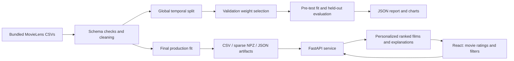

# Application architecture



The browser stores the guest taste profile and watchlist in localStorage. Recommendation requests transmit the selected movie IDs and ratings to the local service. They are processed in memory, not stored in a database. No account, personal identity, or API key is required. Posters use the public Cinemeta/MetaHub image service: `/api/movies/{movieId}/poster` checks the bundled IMDb mapping and redirects the browser to a fixed HTTPS image host. Mapping also checks the movie title so custom datasets cannot inherit an unrelated poster from a reused numeric ID. Image failures leave the artwork fallback visible. Poster requests share the film’s IMDb ID with the image provider; taste profiles and ratings are not sent to that provider. Watched films can be removed on the Watched movies page, and saved bookmarks can be removed individually.

FastAPI loads a fitted model once at startup. A missing/corrupt artifact stops startup with a training instruction. Training never happens silently during a request. Synchronous inference endpoints use FastAPI's worker thread pool. The service binds to loopback by default. It is a local internship app; a public deployment would need its own access control, rate limits, and operational design.

Frontend development uses Vite on port 5173, proxying `/api` to port 8000. A production build is served by the same FastAPI process at port 8000. Requests enforce profile/result bounds, rating half-stars, valid modes, duplicate IDs, valid year ranges, and known movie IDs. Search treats the query as literal text. Browser requests cancel when the inputs change, preventing stale responses from replacing current results.

API summary:

| Route | Purpose |
|---|---|
| `GET /api/health` | Readiness after model loading |
| `GET /api/stats` | Catalog, training counts, genres, blend |
| `GET /api/movies?q=matrix&limit=8` | Literal title search |
| `GET /api/movies/{movieId}` | Movie details |
| `GET /api/movies/{movieId}/description` | Short cached Cinemeta synopsis or an unavailable response |
| `GET /api/movies/{movieId}/poster` | Cached redirect to the mapped movie poster, or 404 |
| `POST /api/home` | Ten personalized picks and ten picks for each chosen/inferred genre |
| `POST /api/recommend` | Rated seeds, filters, mode, diversity, result count and offset |
| `GET /api/evaluation` | Recorded temporal evaluation |
| `GET /docs` | Interactive generated API specification |

```json
{
  "ratings": [{"movieId": 2571, "rating": 5}, {"movieId": 79132, "rating": 4.5}],
  "mode": "hybrid",
  "k": 12,
  "diversity": 0.15,
  "genre": "Sci-Fi"
}
```

`src/cinematch/model.py` is UI independent; `data.py` owns cleaning; `evaluate.py` owns experiment isolation; `api.py` owns validation/serving. The model directory can be overridden with `CINEMATCH_MODEL`; it must be a trusted local artifact, never a client-uploaded path.

## Descriptions, browsing, and genre preferences

`POST /api/recommend` also accepts `favorite_genres` (up to five unique known genres) and `offset` (starting at zero). Each response includes `hasMore` and `nextOffset`. Full collection pages append 24-item batches, cancel stale requests when preferences change, and preserve earlier cards while more films load.

`POST /api/home` uses the same ranking options as the initial full collection. It returns up to ten unseen recommendations and ten per genre, with `genreSource` identifying explicit favorites, watched history, or the catalog fallback. `collections.py` counts genres across all watched films, skips the IMAX format, and resolves count ties alphabetically. Saved and Watch again rows are assembled locally; Watch again includes ratings of at least 3.5, ordered by rating and then most recent addition.

The browser uses refreshable hash routes: `#/`, `#/watched`, `#/genres`, `#/lab`, and `#/collection/recommended`, `saved`, `watch-again`, or `genre/<encoded genre>`. Home rows contain ten preview cards at most and a trailing See more tile linking to the corresponding full collection. The watched search/rating editor lives on its own page.

`GET /api/movies/{movieId}/description` maps the known movie to its IMDb ID, then requests only the description from the fixed HTTPS Cinemeta endpoint. The synopsis is whitespace-normalized, stripped of markup, and limited to 320 characters. The service caps simultaneous external requests at four, uses a six-second network timeout, coalesces duplicate requests, and caches up to 2,048 responses in memory (24 hours for success, two minutes for unavailable results). Missing data/network failures do not block recommendations. No summaries are used as model features or committed as a bulk dataset.

Favorite genres are stored in localStorage and sent only to the local recommendation service. Cinemeta receives movie IMDb IDs, not the guest's profile, favorite genres, or ratings.
